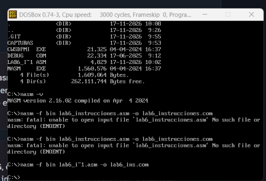
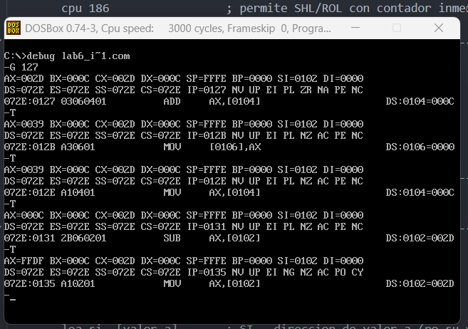
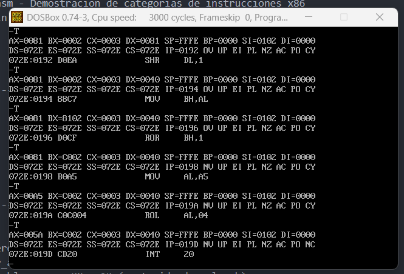
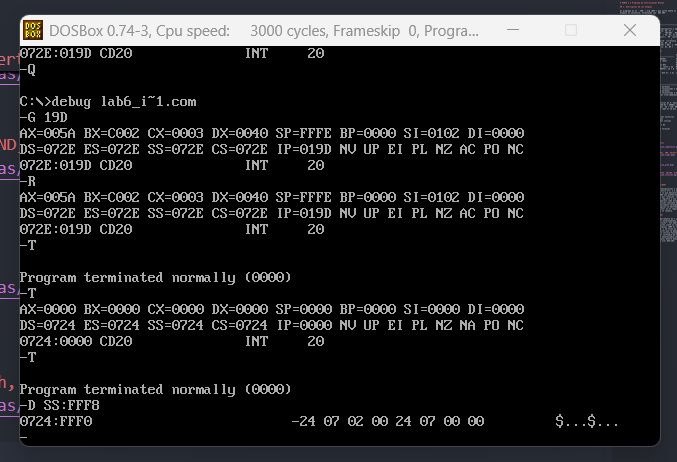
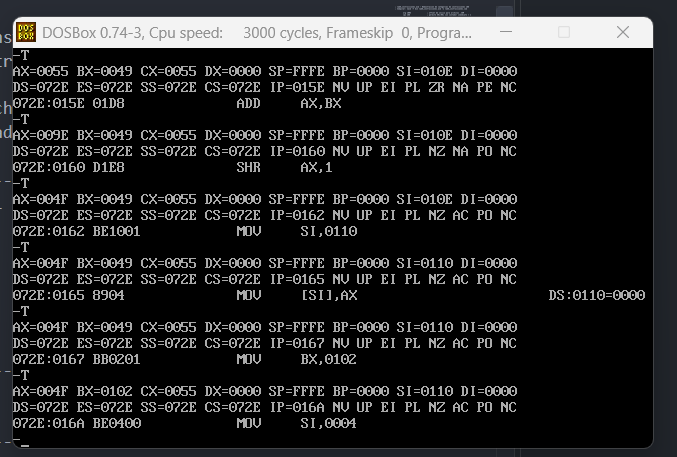
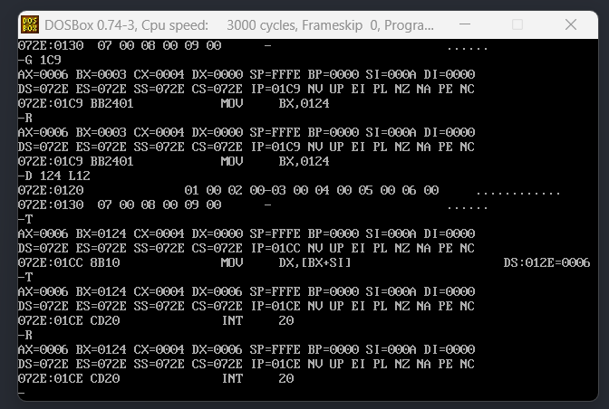

# Post-contenido U6 — Instrucciones y Direccionamiento en NASM sobre DOSBox

**Asignatura:** Arquitectura de Computadores · Unidad 6
**Herramientas:** DOSBox 0.74+, NASM 2.11+, DEBUG

## Este repositorio contiene las dos partes del laboratorio: `lab6_instrucciones.asm` (Parte 1) y `lab6_modos.asm` (Parte 2). Ambos se compilan con `nasm -f bin archivo.asm -o archivo.com`.

# PARTE 1 — Programa de Instrucciones Mixtas

## 1. Descripción de los bloques

El programa es un `.COM` (`org 100h`) que salta sobre sus datos (`jmp inicio`) y ejecuta cinco bloques en secuencia, terminando con `INT 20h`.

| Bloque | Categoría        | Propósito                                                                                       | Registros usados   |
| ------ | ---------------- | ----------------------------------------------------------------------------------------------- | ------------------ |
| 1      | Transferencia    | `MOV` memoria→registro y registro→registro, `LEA` (dirección vs. contenido), `XCHG`, `PUSH/POP` | AX, BX, CX, DX, SI |
| 2      | Aritmética       | `ADD`, `SUB`, `INC/DEC`, `MUL`, `DIV` y su efecto en flags                                      | AX, BX, AL, BL     |
| 3      | Lógica           | `AND` (limpiar), `OR` (activar), `XOR` (invertir / poner a cero), `TEST`, `SHL/SHR`             | AL, BX             |
| 4      | Control de flujo | `CMP` + `JG/JE` (if/else) y bucle con `LOOP` que suma 1..5                                      | AX, BX, CX         |
| 5      | Rotación         | Contraste `SHL`/`ROL` y `SHR`/`ROR` sobre AL=81h; intercambio de nibbles con `ROL al,4`         | AL, BL, CL, DL, BH |

## 2. Registros y flags observados (DEBUG)

| Instrucción                | Resultado               | CF           | ZF  | SF  | OF  |
| -------------------------- | ----------------------- | ------------ | --- | --- | --- |
| `ADD ax,[valor_b]`         | AX = 57 (0039h)         | 0            | 0   | 0   | 0   |
| `SUB ax,[valor_a]` (12−45) | AX = FFDFh (−33)        | 1 (préstamo) | 0   | 1   | 0   |
| `AND al,[mascara]`         | AL = 07h                | 0            | 0   | 0   | 0   |
| `TEST al,01h` (AL=B7h)     | AL sigue en B7h         | 0            | 0   | 0   | 0   |
| `CMP ax,[valor_b]` (45−12) | AX intacto, resta = 33  | 0            | 0   | 0   | 0   |
| Fin de `.bucle_suma`       | AX = 15 (000Fh), CX = 0 | —            | —   | —   | —   |

Otros valores: `MUL bl` → AX = 70 (46h); `DIV bl` → AL = 14 (0Eh), AH = 2; `XOR al,0FFh` sobre AAh → 55h.

**Bloque 5 (rotación), AL = 81h:**

| Instrucción           | Resultado                             | CF  |
| --------------------- | ------------------------------------- | --- |
| `SHL bl,1`            | BL = 02h (bit 7 perdido)              | 1   |
| `ROL cl,1`            | CL = 03h (bit 7 reinsertado en bit 0) | 1   |
| `SHR dl,1`            | DL = 40h (bit 0 perdido)              | 1   |
| `ROR bh,1`            | BH = C0h (bit 0 reinsertado en bit 7) | 1   |
| `ROL al,4` (AL = A5h) | AL = 5Ah (nibbles intercambiados)     | —   |

## 3. Variante factorial (Checkpoint 3)

El bucle de suma se reemplazó por un factorial de 5. Se inicializa `AX = 1`, `CX = 5`, `BX = 1`, y en cada iteración se ejecuta `MUL bx` (DX:AX = AX·BX), luego `INC bx` y `LOOP`. La secuencia de AX es 1, 2, 6, 24, 120, así que al terminar `AX = 120` (0078h). `MUL` sobrescribe DX con la parte alta del producto, pero como el resultado cabe en 16 bits DX queda en 0. El cambio se registró en un commit separado.

```nasm
        mov ax, 1           ; acumulador del factorial
        mov cx, 5           ; 5 iteraciones
        mov bx, 1           ; multiplicador inicial
.bucle_fact:
        mul bx              ; DX:AX = AX * BX
        inc bx
        loop .bucle_fact    ; AX = 120 al terminar
```

## 4. Capturas

#### Compilación sin errores ni advertencias



#### Traza con flags de ADD, SUB, AND, TEST, CMP; AX=57 tras ADD



#### AX=15 al final del bucle



#### Bloque 5: CF=1 y BL=02h, CL=03h, DL=40h, BH=C0h, AL=5Ah



## 5. Decisión técnica 1 — ¿SHL/SHR o ROL/ROR?

SHL/SHR son la opción correcta cuando la manipulación es aritmética: desplazar a la izquierda multiplica por 2^n y a la derecha divide entre 2^n, y en ambos casos el bit que sale del registro no aporta nada al resultado numérico, por lo que descartarlo es el comportamiento deseado (como en el Bloque 3, donde 8 << 2 = 32). ROL/ROR son preferibles cuando la información no debe perderse: intercambio de nibbles, cifrado por rotación o checksums circulares. Con AL = 81h, tras `SHL al,1` el bit 7 original (1) sale del registro y solo queda visible en CF, mientras AL queda en 02h; tras `ROL al,1` ese mismo bit reaparece como el nuevo bit 0 y AL vale 03h, además de CF=1. Esa diferencia determina qué instrucción conviene. SHL nunca podría intercambiar los nibbles de un byte: cada desplazamiento introduce ceros por la derecha y descarta bits por la izquierda, de modo que el nibble alto original se destruye y ningún `OR` posterior puede recuperarlo, porque la información ya no está en el registro. `ROL al,4` lo logra en una instrucción porque nada se descarta, solo se reubica.

## 6. Decisión técnica 2 — ¿LOOP o DEC/JNZ?

LOOP combina en una sola instrucción el decremento de CX y el salto si CX ≠ 0, lo que hace el código más compacto (un byte de opcode más desplazamiento, frente a dos instrucciones) y expresa con claridad la intención de "repetir CX veces". Sin embargo, escribir menos instrucciones no implica gastar menos ciclos: cada instrucción tiene su propio costo de decodificación y ejecución según la microarquitectura. En el 8086 original LOOP era ligeramente más rápida que DEC+JNZ, pero en procesadores posteriores (desde el 286, y de forma muy marcada en los modernos) LOOP se implementa con microcódigo y tarda más ciclos que la pareja DEC/JNZ, que los procesadores actuales ejecutan de forma muy eficiente e incluso fusionan (macro-fusion). Por eso el conteo de líneas de código fuente no es un indicador confiable del tiempo real. Para el bucle de 5 iteraciones del Bloque 4 la diferencia es despreciable, imperceptible para cualquier usuario. Si el mismo bucle se ejecutara millones de veces dentro de un programa mayor, la diferencia acumulada sí sería relevante y convendría usar DEC/JNZ.

---

# PARTE 2 — Modos de Direccionamiento

## 1. Estructura de datos

Se definen en `lab6_modos.asm`: `array` (5 words: 10, 20, 30, 40, 50), `nota1` (85), `nota2` (73), `promedio` (0), `var_x` (0FFFFh), `tabla_hex` y `matriz` (3×3 words: 1..9). Las direcciones exactas se obtienen con el listado de NASM (`nasm -f bin lab6_modos.asm -o lab6_modos.com -l lab6_modos.lst`) y se confirman con `D` en DEBUG. En little-endian el array aparece como `0A 00 14 00 1E 00 28 00 32 00`, `nota1` como `55 00` (0055h = 85) y `nota2` como `49 00` (0049h = 73).

## 2. Tabla resumen de modos

| Modo                      | Fórmula de la dirección efectiva                   | Instrucción NASM                        | Valor observado en DEBUG                |
| ------------------------- | -------------------------------------------------- | --------------------------------------- | --------------------------------------- |
| Inmediato                 | No hay acceso a memoria: el dato está en el opcode | `MOV ax, 100`                           | AX = 0064h (`U` muestra `MOV AX,0064`)  |
| Directo                   | EA = dirección fija del símbolo                    | `MOV ax, [var_x]`                       | AX = FFFFh                              |
| Directo                   | EA = dirección de `array`                          | `MOV bx, [array]`                       | BX = 000Ah (10)                         |
| Indirecto por registro    | EA = SI                                            | `MOV ax, [si]` (SI = `nota1`)           | AX = 0055h (85)                         |
| Indirecto por registro    | EA = SI                                            | `MOV [si], ax` (SI = `promedio`)        | mem[promedio] = 004Fh (79)              |
| Indexado                  | EA = BX + SI                                       | `MOV ax, [bx + si]` (SI = 4)            | AX = 001Eh (30) = `array[2]`            |
| Indexado con bucle        | EA = BX + SI, SI += 2                              | `ADD ax, [bx + si]`                     | AX = 0096h (150)                        |
| Base + desplazamiento     | EA = BX + 2 / BX + 4                               | `MOV cx, [bx + 2]`                      | CX = 0049h (73), DX = 004Fh (79)        |
| Indirecto con BP          | EA = BP − 2, BP − 4 (segmento SS)                  | `MOV ax, [bp - 2]` / `ADD ax, [bp - 4]` | AX = 015Dh (349)                        |
| Doble indexación (matriz) | EA = BX + SI, SI = fila·6 + col·2                  | `MOV dx, [bx + si]`                     | SI = 000Ah, DX = 0006h = `matriz[1][2]` |

## 3. Trazado del modo indirecto (Checkpoint 2)

Valores típicos al iniciar un `.COM` en DEBUG (SI = 0000h); las direcciones dependen del listado.

| Instrucción        | Registro modificado | Valor resultante                   |
| ------------------ | ------------------- | ---------------------------------- |
| `MOV si, nota1`    | SI                  | 0000h → dirección de `nota1`       |
| `MOV ax, [si]`     | AX                  | 0055h (85)                         |
| `MOV si, nota2`    | SI                  | dirección de `nota2` (`nota1` + 2) |
| `MOV bx, [si]`     | BX                  | 0049h (73)                         |
| `ADD ax, bx`       | AX                  | 009Eh (158)                        |
| `SHR ax, 1`        | AX                  | 004Fh (79)                         |
| `MOV si, promedio` | SI                  | dirección de `promedio`            |
| `MOV [si], ax`     | mem[promedio]       | 004Fh (79)                         |

## 4. Marco de pila con BP (Checkpoint 4)

Valores típicos con SP = FFFEh al inicio (pueden variar en DOSBox):

| Momento                       | SP    | BP                     |
| ----------------------------- | ----- | ---------------------- |
| Tras `PUSH bp` y `MOV bp, sp` | FFFCh | FFFCh                  |
| Antes de `SUB sp, 4`          | FFFCh | FFFCh                  |
| Después de `SUB sp, 4`        | FFF8h | FFFCh                  |
| Tras `MOV sp, bp` y `POP bp`  | FFFEh | valor original (0000h) |

`D SS:BP-4` debe mostrar `FA 00 63 00` (250 en BP−4 y 99 en BP−2, little-endian). Tras `ADD ax,[bp-4]`, AX = 015Dh (349).

## 5. Acceso a matriz 3×3 (Checkpoint 5)

Para `matriz[1][2]`: fila·ancho = 1·3 = 3 elementos, ×2 bytes = 6; columna 2 ×2 bytes = 4; SI = 6 + 4 = 10 (0Ah). Con `BX = matriz`, `[bx + si]` apunta al sexto word (valor 6), así que DX = 0006h.

## 6. Capturas

#### Dump `D DS:100` con array, nota1 y nota2 identificados


#### AX=150 en el bucle original y en el inverso



#### SP/BP antes y después, `D SS:BP-4`, AX=015Dh


#### Dump de la matriz, SI=0Ah y DX=0006h



## 7. Decisión técnica 3 — ¿Modo directo o indexado para un elemento fijo?

Cuando la posición del elemento se conoce al compilar, el ensamblador puede resolver toda la aritmética de direcciones y embeber la dirección final en el opcode, de modo que `MOV dx, [matriz + 10]` es una sola instrucción con una única lectura de memoria. El indexado del Paso 7 paga en ejecución una `MUL` (muy costosa en ciclos), dos `SHL`, un `ADD` y varios `MOV` solo para reconstruir en tiempo de ejecución una dirección que ya era conocida de antemano; es trabajo repetido cada vez que se ejecuta el código. El modo indexado se vuelve indispensable cuando la fila o la columna dependen de una variable calculada en ejecución, por ejemplo el índice de un bucle, una entrada del usuario o un parámetro de una rutina, porque entonces la dirección no existe en tiempo de compilación. Para sumar las 9 posiciones, usar 9 accesos directos con 9 etiquetas sería impráctico: el código crecería con el tamaño de la matriz, sería difícil de mantener y no serviría para otras dimensiones, mientras que un solo bucle indexado con `[bx + si]` resuelve el problema con pocas instrucciones y escala a cualquier tamaño.

## 8. Decisión técnica 4 — BP frente a BX/SI

La arquitectura x86 asigna segmentos por defecto según el registro base: BX, SI y DI usan DS, pensados como punteros a datos, mientras que BP usa SS, pensado para acceder a variables locales y parámetros relativos a la pila (marco de pila). Esta separación permite que una rutina acceda a su marco sin depender del valor de DS y que apunte a datos globales sin tocar la pila, por lo que no son intercambiables en la práctica. En este laboratorio, al ser un `.COM`, CS, DS, ES y SS coinciden, así que `[bp+x]` y `[bx+x]` producen el mismo resultado observable. En un `.EXE` con DS ≠ SS la diferencia es crítica: si el código supone que `[bp + desplazamiento]` apunta al segmento de datos, leerá o escribirá bytes de la pila en lugar de la variable esperada, con resultados incorrectos o corrupción de la pila sin que el ensamblador avise. Para forzar a BP a usar DS se emplea un prefijo de sobrescritura de segmento, por ejemplo `mov ax, [ds:bp+2]`. Tiene sentido cuando una rutina que ya usa BP como marco de pila necesita leer una tabla global del segmento de datos con ese mismo registro base.

---
